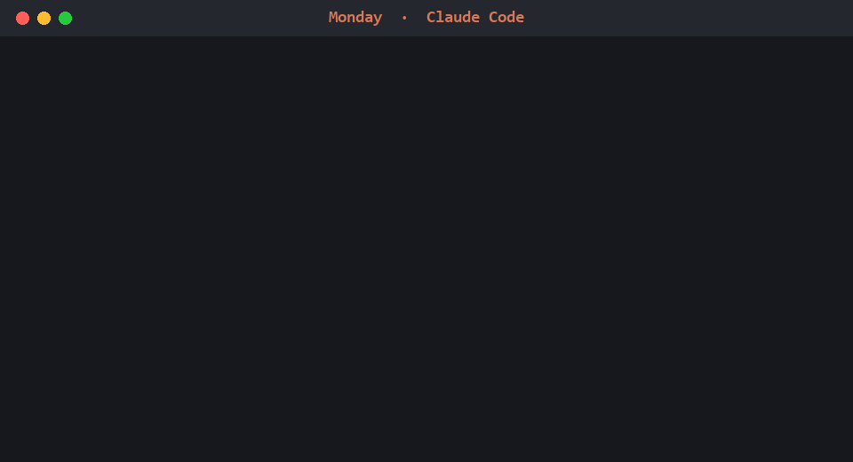
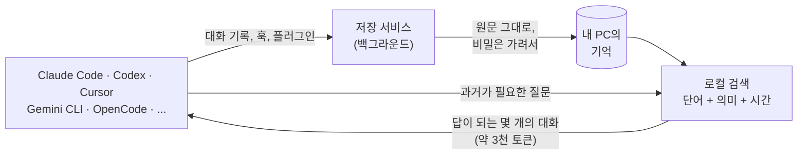

<div align="center">

# Graph-MIND

### AI는 세션이 끝나면 다 잊어버립니다. 이건 기억합니다. 그것도 LLM을 한 번도 부르지 않고요.

**LongMemEval 88.8%. 기억을 저장하는 데 쓰는 모델 토큰 0. 내 PC에서 돌아갑니다.**

[![][license-shield]][license-link]
[![][python-shield]][python-link]
[![][platform-shield]][platform-link]
[![][longmemeval-shield]][benchmarks-link]
[![][ci-shield]][ci-link]
[![][pypi-shield]][pypi-link]

*월요일에 한 에이전트와 정한 걸, 수요일에 다른 에이전트한테 물어보세요. 알고 있습니다.*

[English](README.md) · **한국어**



</div>

## 설치

Windows: [Graph-MIND-Setup.cmd](https://raw.githubusercontent.com/goyohan0611-png/graph-mind/main/scripts/Graph-MIND-Setup.cmd)를
받아서 더블클릭하거나, PowerShell에서:

```powershell
irm https://raw.githubusercontent.com/goyohan0611-png/graph-mind/main/scripts/install.ps1 | iex
```

macOS / Linux:

```bash
curl -LsSf https://raw.githubusercontent.com/goyohan0611-png/graph-mind/main/scripts/install.sh | sh
```

Python이 없어도 되고, 따로 설정할 것도 없습니다. 설치 후 AI 앱을 한 번 껐다 켜세요. Python이 이미
있다면 `pip install graph-mind-memory && graph-mind-install`. 자세히: [docs/install.md](docs/install.md)

<details>
<summary>MCP 클라이언트에 직접 연결하기</summary>

`pip install graph-mind-memory` 후:

```json
{
  "mcpServers": {
    "graph-mind-memory": {
      "command": "python",
      "args": ["-m", "graph_mind.mcp_server"]
    }
  }
}
```

Claude Code: `claude mcp add graph-mind-memory -- python -m graph_mind.mcp_server`. 이렇게 하면 도구만
연결됩니다. 대화 자동 저장까지 쓰려면 `graph-mind-install`을 실행하세요.
</details>

## 써보기

평소처럼 일하다가, 새 세션이나 다른 앱, 다른 모델에서 물어보세요.

- *"어제 어디까지 했지?"*
- *"결제 서비스 DB 뭘로 하기로 했었지? 이유가 뭐였더라?"*
- *"지난주에 인증 미들웨어 어디 고쳤어?"*
- *"우리 강아지 이름이 뭐였지?"* (지나가듯 한 번 말한 것도)

따로 태그를 달거나 저장할 필요가 없습니다. 모든 대화가 이미 저장돼 있고, 에이전트는 질문에 답이
되는 몇 개만 꺼내 봅니다.

## 하는 일

- **터미널의 모든 에이전트가 쓰는 하나의 기억.** 어떤 코딩 에이전트나 모델을 쓰든 같은 기억을 읽고
  씁니다. 에이전트나 모델을 바꿔도 기억은 그대로입니다.
- **대화를 토씨 하나 안 바꾸고 기억합니다.** 내 PC에. 저장은 DB에 쓰는 것뿐이라 모델 호출도, 토큰도
  들지 않습니다. 과거가 필요한 질문이 오면 답이 되는 수천 토큰만 돌려줍니다. 한국어와 영어.
- **여러 PC에서 같은 기억.** `graph-mind folder share`를 실행하고, 다른 PC에서
  `graph-mind folder <코드>`. (AI는 명령어를 알려줄 뿐 기억을 스스로 옮기지 않습니다. 그래서 웹페이지가
  AI를 속여도 못 옮깁니다.) 사무실 네트워크나 [Tailscale](https://tailscale.com), TLS, PC를 떠나기
  전에 한 줄씩 암호화.
- **내 것.** 계정 없음, 자체 클라우드 없음, 사용 기록 수집 없음. 비밀번호·API 키 같은 건 저장 전에
  가려지고, *"아까 친 비밀번호 지워줘"* 하면 모든 곳에서 지워집니다. [docs/privacy.md](docs/privacy.md)
- **원하면 팀으로.** 프로젝트의 결정과 진행 상황을 팀원의 AI와 공유합니다. 개인 기억은 절대
  공유하지 않습니다. [docs/teams.md](docs/teams.md)

## 지원하는 앱

설치 프로그램이 찾아서 연결합니다. 새 앱을 깔았으면 한 번 더 실행하세요.

| 앱 | 대화 저장 | 방식 |
|---|---|---|
| Claude Code | 모든 대화 | 대화 기록 파일을 읽음 |
| Codex CLI | 모든 대화 | 대화 기록 파일을 읽음 |
| Cursor | 모든 대화 | 대화 기록 파일을 읽음 |
| Copilot CLI | 모든 대화 | 대화 기록 파일을 읽음 |
| Claude Desktop (Cowork) | 모든 대화 | 세션 파일을 읽음 |
| Gemini CLI | 모든 대화 | 훅. 답하기 전에 관련 기억도 넣어줌 |
| OpenCode | 모든 대화 | 플러그인. 답하기 전에 관련 기억도 넣어줌 (어떤 모델이든) |
| Claude Desktop 채팅, Windsurf, VS Code Copilot, Cline, LM Studio | 모델이 저장한 것 | MCP 도구 |

다른 MCP 클라이언트도 도구로 쓸 수 있습니다. 위의 "직접 연결하기"를 보세요.

## 동작 방식



- **저장에 비용이 들지 않습니다.** 말한 그대로 저장합니다. 저장할 때 모델이 요약하거나 뽑아내지
  않으니, 들어가면서 빠지거나 지어낸 게 섞이지 않고 토큰도 쓰지 않습니다.
- **검색은 내 PC에서.** 단어 검색, 작은 다국어 임베딩 모델(ONNX, GPU 불필요), 언제 한 말인지를 함께
  봅니다. 에이전트는 기록 전체가 아니라 원문 대화가 담긴 짧은 묶음을 받습니다.
- **생각은 이미 쓰는 모델이 합니다.** Graph-MIND는 근거를 건네고, 답은 모델이 합니다. 모델이 좋아지면
  기억은 그대로여도 답이 좋아집니다.

## 정말 되나요?

[LongMemEval](https://github.com/xiaowu0162/LongMemEval)은 장기 대화 기억을 재는 공개 벤치마크입니다.
질문 500개, 질문마다 과거 대화 세션 약 50개. 아래는 모두 같은 답변 모델(gpt-5-mini), 같은 프롬프트,
공식 gpt-4o 채점기를 썼고 기억 시스템만 다릅니다.

| | 정확도 | 기억 **저장**에 쓴 모델 토큰 | 답변 모델이 읽는 분량 |
|---|---|---|---|
| **Graph-MIND** | **88.8%** (500문항 전체) | **0** | **3.4천 토큰** |
| agentmemory | 80.4% (같은 499문항) | — | 약 1만 6.5천 토큰 |
| MemPalace 3.10.0 | 57.5% (40문항) | 0 | — |
| Mem0 2.2.1 (오픈소스) | 52.5% (40문항) | 질문당 약 64만 | — |

agentmemory와 같은 499문항에서 Graph-MIND는 89.0%, 같은 40문항에서는 85.0%였습니다. 검색만 놓고
agentmemory 자신의 기준(답이 든 세션이 상위 5개 안에 있는가)으로 재면 Graph-MIND 98.5%,
agentmemory 95.2%.

모든 질문, 답, 채점 결과는 [`research/runs/`](research/runs)에 있고, 방법·실패·재현 방법은
[docs/benchmarks.md](docs/benchmarks.md)에 있습니다.

## 자주 묻는 질문

**PC가 느려지지 않나요?** 백그라운드 서비스는 새 대화가 없을 때 CPU 코어 하나의 약 2%, 메모리 약
830MB(대부분 검색 모델)를 씁니다. 기억 검색은 약 25ms(95번째 백분위), 앱을 켜고 첫 검색은 약 1.3초.

**돈이 드나요?** 아니요. API 키도 필요 없고 자체적으로 모델을 부르지 않습니다. 과거가 필요한 질문이
오면 쓰고 있는 AI 앱이 약 3천 토큰을 읽을 뿐입니다.

**내 데이터가 밖으로 나가나요?** 아니요. 내 다른 PC나 팀과 공유할 때만 나갑니다. 사용 기록 수집도
없습니다. API 키, 비밀번호, 카드 번호 같은 건 저장 전에 가려집니다.

**CLAUDE.md나 앱 자체 메모리 기능과 뭐가 다른가요?** 그쪽은 모델이 쓴 메모를 앱마다 따로 갖고
있습니다. Graph-MIND는 모든 대화를 원문 그대로 갖고, PC의 모든 앱과 모델이 함께 씁니다.

**한국어 되나요?** 됩니다. 한국어·영어 대화 모두, 질문도 어느 쪽 언어로든. 영어로만 말한 내용을
한국어로 물으면 대부분 찾지만, 항상은 아닙니다.

**지우려면?** `graph-mind-uninstall`이 모든 앱 연결을 끊고 서비스를 멈춥니다. 기억은 `~/.graph-mind`에
남고, `--purge`를 붙이면 기억까지 지웁니다.

> [!NOTE]
> **알파 버전.** Windows에서 매일 쓰고 있습니다. macOS와 Linux는 CI에서 모든 테스트를 통과하지만 아직
> 매일 쓰이지는 않았습니다.

## 더 보기

[MCP 도구](docs/install.md#mcp-tools) · [기억을 3D로 보기](docs/privacy.md#seeing-your-memory)
(`graph-mind-view`) · [변경 기록](CHANGELOG.md) · [보안](SECURITY.md)

기여는 [CLA](CLA.md)에 따라 환영합니다. 라이선스: [AGPL-3.0](LICENSE). 변경 내용을 공개할 수 없는
제품에는 [상용 라이선스](COMMERCIAL.md)를 드립니다.

<!-- Links -->
[license-shield]: https://img.shields.io/badge/license-AGPL--3.0-4dc9f6?style=flat-square
[license-link]: LICENSE
[python-shield]: https://img.shields.io/badge/python-3.10+-7dd8f8?style=flat-square&logo=python&logoColor=white
[python-link]: https://www.python.org/
[platform-shield]: https://img.shields.io/badge/platform-Windows%20%7C%20macOS%20%7C%20Linux-b0e8ff?style=flat-square
[platform-link]: docs/benchmarks.md#known-limits
[longmemeval-shield]: https://img.shields.io/badge/LongMemEval-88.8%25-2ea44f?style=flat-square
[benchmarks-link]: docs/benchmarks.md
[ci-shield]: https://img.shields.io/github/actions/workflow/status/goyohan0611-png/graph-mind/tests.yml?style=flat-square&label=tests
[ci-link]: https://github.com/goyohan0611-png/graph-mind/actions/workflows/tests.yml
[pypi-shield]: https://img.shields.io/pypi/v/graph-mind-memory?style=flat-square&label=pypi
[pypi-link]: https://pypi.org/project/graph-mind-memory/
