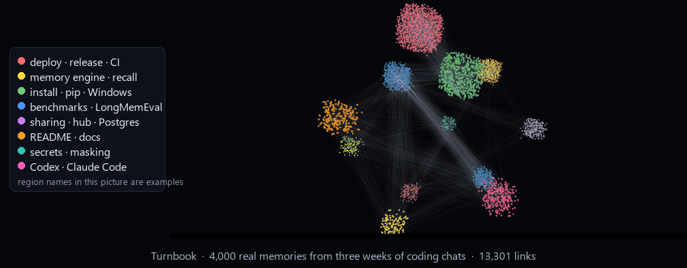

<!-- mcp-name: io.github.goyohan0611-png/graph-mind -->
<div align="center">

# Graph-MIND

### Your AI forgets everything when the session ends. This one remembers, and it never calls an LLM to do it.

**88.8% on LongMemEval. Zero model tokens spent saving memory. Runs on your own PC.**

[![][license-shield]][license-link]
[![][python-shield]][python-link]
[![][platform-shield]][platform-link]
[![][longmemeval-shield]][benchmarks-link]
[![][ci-shield]][ci-link]
[![][pypi-shield]][pypi-link]

*Decide something in Claude Code on Monday. Ask Codex on Wednesday. It knows.*


<sub>A real run, not a mock-up: <code>python demo/record_demo.py</code> records it from a fresh store.</sub>

</div>

### The part that sounds wrong

Same 40 questions, same answer model, same prompt, same official judge, pre-registered before
anyone looked:

| | accuracy | model tokens spent **saving** memory, per question |
|---|---|---|
| **Graph-MIND** | **85.0%** | **0** |
| MemPalace 3.10.0 | 57.5% | 0 |
| Mem0 2.2.1 (open source) | 52.5% | ~640,000 |

Mem0 runs an LLM over your conversations to decide what to keep. Graph-MIND keeps them word for
word and finds the right part when you ask. It is cheaper, and in this test it was also more
accurate.

**Don't believe it? Good.** Every question, answer and judge verdict is in
[`research/runs/`](research/runs), and [REPORT.md](research/REPORT.md) shows how to rerun it,
including the runs that went wrong. Or just try it on your own conversations:

```bash
pip install graph-mind-memory
graph-mind-install          # connects Claude Code, Codex, Claude Desktop, Cursor, VS Code, ...
```

> [!NOTE]
> **Alpha.** Windows: used daily, with full end-to-end checks (fresh install, two PCs, real
> Claude and Codex). macOS and Linux: tests and a clean install from PyPI pass in CI on every
> release and every day, but nobody has used them day to day yet; consider them experimental.

---

## What it is

Graph-MIND records every conversation you have with **Claude Code, Codex and Claude Desktop**, word
for word, in a store on your own PC. When a question depends on the past, the model you are using
calls Graph-MIND over MCP and gets back a few thousand tokens of the conversations that answer it.

- **Nothing is summarised or rewritten.** Saving is a database write. No model call, no tokens.
- **Search is hybrid.** Your words are embedded on your PC (multilingual MiniLM, no API) and fused
  with keyword search. Korean and English both work.
- **Capture is automatic.** A background service reads each app's local transcripts, masks secrets,
  stores the turns and embeds them as they arrive.
- **One memory across your PCs.** One sentence to the AI on the first PC, one command on the
  others (see [below](#one-memory-across-pcs)).
- **No cloud of its own.** No account, no telemetry; the memory stays on your machines. What
  leaves them is what your AI app already sends: the recalled turns go to your model's
  provider with your question.

---

## Benchmarks

All numbers below come from files in this repository: the pre-registrations, each question's
answer, and the judge's verdict on it, under [`research/runs/`](research/runs). The method is in
[REPORT.md](research/REPORT.md), including the failures and the corrections.

**LongMemEval_S: answer accuracy, 500 questions.** The answer model is gpt-5-mini; the judge is the
official gpt-4o-2024-08-06.

| | accuracy | model tokens at write time | packet read per question |
|---|---|---|---|
| **All 500 questions** | **88.8%** (444/500) | **0** | 3.4k tokens |
| The 380 never used for tuning | **86.8%** (330/380) | 0 | 3.4k tokens |

**Head to head** ([table above](#the-part-that-sounds-wrong)): the run was pre-registered with
code hashes, and nobody had tuned on those 40 questions. Graph-MIND ran its shipped path with the
earlier 20-item packet; Mem0 2.2.1 was the latest open-source release on PyPI. Graph-MIND's lead
over both is significant (exact McNemar p = 0.002 and 0.003); with 40 questions, each score has an
interval of about ±14 points.

**Reading other published numbers.** They measure different things, so they do not compare
directly with the tables above:

- **MemPalace's 96.6%** is retrieval recall (R@5): is the right session among the five returned?
  This table measures whether the final answer is correct.
- **Mem0's 94.4%** is its managed cloud platform, which includes proprietary components. The open
  source package tested here is a different system.
- **Mastra (94.87%), Emergence (86%), Supermemory (85.2%) and Zep (71.2%)** report their own setups
  and answer models. They were not reproduced here.

As far as we know, everything above 85% on that list runs a model over your conversations when it
saves them. Graph-MIND does not.

---

## Install

**One step, no Python needed.** On Windows, download
[Graph-MIND-Setup.cmd](https://raw.githubusercontent.com/goyohan0611-png/graph-mind/main/scripts/Graph-MIND-Setup.cmd)
and double-click it (Windows may ask once whether to run a downloaded file), or paste this in
PowerShell:

```powershell
irm https://raw.githubusercontent.com/goyohan0611-png/graph-mind/main/scripts/install.ps1 | iex
```

On macOS or Linux:

```bash
curl -LsSf https://raw.githubusercontent.com/goyohan0611-png/graph-mind/main/scripts/install.sh | sh
```

It installs [uv](https://docs.astral.sh/uv/) for your user (no administrator rights), which
brings its own Python; installs Graph-MIND with it; and connects every AI app it finds. Restart
your AI apps afterwards. To join another PC's memory or a team, paste the code you were given to
your AI ("이 코드로 연결해줘"); either kind of code works there.

With Python already set up (3.10+, 64-bit; Windows, macOS or Linux, on x86-64 or 64-bit ARM):

```bash
pip install graph-mind-memory
graph-mind-install
```

The first time a machine hosts a brain or a hub, Graph-MIND downloads Postgres 16 for it once (12
MB, 46 MB on Windows; checked against a pinned hash) and keeps it in the user's cache folder.
What changed in each release: [CHANGELOG.md](CHANGELOG.md).

If `graph-mind-install` is "not recognized", pip put it in a Scripts folder that is not on your
PATH (common with the Windows Python install manager). `python -m install` runs the same thing.
If it stops with a DLL load error, Windows is missing the Microsoft Visual C++ runtime that the
embedding runtime needs: install [vc_redist.x64.exe](https://aka.ms/vs/17/release/vc_redist.x64.exe),
restart, and run the installer again.

or from source:

```bash
git clone https://github.com/goyohan0611-png/graph-mind.git
cd graph-mind
python src/install.py
```

The installer:

- installs the packages (no PyTorch: the embedding model runs on ONNX Runtime);
- registers the MCP server with every app it finds: Claude Code, Claude Desktop (including the
  Microsoft Store build), Codex, Cursor, Windsurf, Gemini CLI, VS Code (Copilot), Cline and
  LM Studio;
- starts the capture service at login (Windows Startup folder, a macOS LaunchAgent, or an XDG
  autostart entry on Linux);
- downloads the embedding model (about 470 MB, once).

Then restart your AI apps. The server is also listed in the
[MCP Registry](https://registry.modelcontextprotocol.io) as `io.github.goyohan0611-png/graph-mind`. Running the installer again is safe. Run it again if you move the folder.

> [!TIP]
> If `pip` fails with "No such file or directory", Windows' 260-character path limit is the usual
> cause. Clone to a short path such as `C:\graph-mind`, or enable long paths. The installer prints
> the command for that.

To remove it: `graph-mind-uninstall` unregisters it from every app, removes the login item and
stops the capture service. Your memory stays in `~/.graph-mind` unless you add `--purge`. Then
`pip uninstall graph-mind-memory` removes the program.

---

## What it captures

| app | captured |
|---|---|
| Codex: terminal, VS Code, ChatGPT desktop's work mode | every turn |
| Claude Code: terminal, VS Code, Claude desktop's Code tab | every turn |
| Claude desktop: Cowork | every turn |
| Claude desktop: chat | what the model saves with `brain_remember` |
| Cursor, Windsurf, Gemini CLI, VS Code, Cline, LM Studio | what the model saves with `brain_remember` (memory tools connected; their transcripts are not read yet) |

Before anything is stored, these are masked: API keys, tokens from GitHub, AWS, Google and Slack,
private keys, passwords inside URLs, values written after `password:` / `api_key=` / `token:`,
and any long machine-random string even from a service no rule knows (by its randomness: 91% of
random 20-64 character tokens caught; in 246,750 ordinary chat turns it fired 92 times, nearly
all on real ids and tokens). Commit ids, hashes and UUIDs are kept, since you recall those on
purpose.

Keep masking on if you use a cloud model: a recalled memory goes to your model's provider with the
question, so a stored key would leave your PC the first time it is useful. To have Graph-MIND
remember a key, tell it **where the key is**, not the key: *"my OpenAI key is in 1Password, under
Dev"*. If your model runs on your own machines and you want keys remembered as typed, add
`"mask_secrets": false` to `~/.graph-mind/config.json` (applies from the next message; already
masked text stays masked).

Only what you actually send is captured: the service reads each app's transcript, which is written
after you press Enter, so a paste you delete before sending never reaches it. A plain password
like `hunter2` has no recognizable format and is **not** masked. To remove something,

just ask your AI: *"delete the password I typed earlier"*. It lists masked candidates
(`wifi password is ****`), deletes only the ones you pick, and the conversation about deleting
is not saved. Or, from a terminal:

```bash
graph-mind-forget          # asks for the phrase without showing it, then confirms
```

Either way, what you pick is deleted from this PC and its search indexes, from the shared memory,
and from your other PCs on their next sync; only ids are shared for that, never the text. Your AI
app's own history (for Claude Code, `~/.claude/projects`) is separate and is not touched.

---

## MCP tools

| tool | what it does |
|---|---|
| `brain_context` | a bounded packet of the past turns and memories that answer a request; `recent=true` for "where did we leave off?" |
| `brain_recall` | look memories and captured turns up directly; `entity=` for everything about one thing, in order |
| `brain_remember` | save a sourced memory or decision (secrets masked) |
| `brain_folder` | where the memory lives; share it with your other PCs; reindex an imported backlog |
| `brain_forget` | "delete the password I typed": lists masked candidates, deletes only what you pick, everywhere; the exchange itself is not saved |
| `code_activity` | what changed in a project, file or symbol, and when (when a code folder is watched) |

Six tools on purpose: every tool's description is read by the model on every turn, and similar
tools get confused with each other. Version 0.1 had thirteen.

---

## See your memory

<div align="center">

</div>

```bash
graph-mind-view              # opens your memory as a 3D graph in the browser
graph-mind-view --no-text    # the same picture with no conversation text in the file
```

Every conversation turn and memory is a point; the links are the associations recall already
uses (shared words and names, neighbours in time). Points that keep coming up together gather
into coloured regions, each named by its most particular words. Hover a point to read it; click
to fly to it. The page is a local file (`~/.graph-mind/brain.html`); only the 3D library is
fetched from a CDN. Use `--no-text` before you screenshot or share it.

## One memory across PCs

On the PC that holds the memory, tell its AI:

> *"Let my other PCs use this memory."*

It replies with a connection code (`gm1.…`). On each other PC:

```bash
graph-mind-install --join gm1.…     # or: python src/install.py --join gm1.…
```

The memory then lives in a Postgres server on the first PC, which Graph-MIND sets up itself. Other
PCs reach it over the local network in the office, or over [Tailscale](https://tailscale.com) from
anywhere. Each connection tries the addresses in turn and uses the first that answers.

Other PCs log in with a generated password, as a role that can reach only the memory database,
over TLS only: the code carries the hub's own certificate, so a PC accepts that hub and nothing
in between. The Windows firewall rule admits only the local network and Tailscale. Every line of
memory is also encrypted (AES with an HMAC) under a key derived from that password before it
leaves a PC, so the hub's own database holds only ciphertext. The code contains the password: do
not post it publicly.

A synced folder also works. Tell the AI *"use my Google Drive's Graph-MIND folder as my memory"* on
each PC.

The `gm1.` code is for **your own** PCs: it shares your whole personal memory. Never give it to a
teammate; invite them to a project brain instead.

## Project brains (optional, for teams)

Graph-MIND is a personal memory first: the sections above work alone, for one person on any
number of PCs. Teams that want it can add project brains. Everyone keeps a private brain; every
project they choose to share has a shared one. A person can be in several (a side
project alone, Graph-MIND with four developers, a company product with six), and each keeps its
own members, decisions, progress and instructions. Nothing personal moves into a project by
itself: only what someone publishes. Files and the talk about them stay where teams already keep
them (Slack, a drive, GitHub); the project brain is what lets another person's AI pick the work
up.

> A: *"Postgres 문제 수정 끝냈어. 공유해."* → a checkpoint in the Graph-MIND project: what changed
> and why, files, tests, the commit at the stage it reached, what is left.
> A: *"제안서 슬랙에 올렸어. 프로젝트에도 남겨줘."* → a checkpoint with the Slack link and what
> to check.
> B, next day, in another app: *"어제 Postgres 문제 어떻게 됐고 남은 게 뭐야?"*

- **Checkpoints**: decision, progress, blocker, next action, artifact, release; who, when, the
  context (what changed, where, why, how it was verified, what is left, what to check), what
  they supersede. A mistaken one can be retracted.
- **Links, not files**: a git folder is linked by repository, branch and commit with the stage it
  really reached (committed, pushed, PR open, merged, released), so a commit on one PC is never
  reported as done; a Slack message or a drive document is kept as its link.
- **Instructions**: each project can carry standing guidance for every AI that works on it.
- **Members, as on GitHub**: whoever creates a project owns it. Only owners add people (owner,
  editor or viewer), set the instructions or take back someone else's checkpoint; editors
  publish, viewers read. *"민지를 graph-mind 프로젝트 편집자로 초대해"* gives a code for her; her
  AI joins with it. Every action, reads included, is in an audit log.
- **Each project its own brain**: its own key and, on a hub, its own schema and groups in a
  database apart from anyone's personal memory, so it can be backed up, moved or removed whole.
  When a project's home cannot be reached, the assistant says the latest state is unknown
  instead of guessing.

### Where a project lives

- **A Postgres hub.** A PC, server or NAS runs the hub; the database itself enforces each
  project's permissions, and teammates' logins cannot reach anyone's personal memory. Teammates
  reach it on the office network, or from anywhere over [Tailscale](https://tailscale.com)
  (install Tailscale on the hub and on each PC, sign in to the same tailnet; invite codes carry
  the hub's Tailscale address and use it when the office network is not there). Whoever runs the
  hub runs the server and sees a project only when its owner adds them. A server needs no AI and
  no API key, only `pip install graph-mind-memory` (any Python from 3.10; Windows, macOS, or Linux
  on x86-64 or 64-bit ARM, such as a Raspberry Pi or an ARM NAS) and these commands:

  ```bash
  graph-mind-hub host                # once: this machine becomes a hub (it stays one)
  graph-mind-hub add-user 민지        # an account and the code to give her (no projects yet)
  graph-mind-hub users               # accounts and their roles; never what is in a project
  graph-mind-hub remove-user 민지 --transfer-to 준   # projects only she owned go to 준
  graph-mind-hub delete-project 이름 --confirm 이름
  graph-mind-hub audit
  ```
- **This PC alone**: without a hub, projects stay in `~/.graph-mind/ledger.sqlite`.

---

## Reproducing the benchmarks

1. Download `longmemeval_s_cleaned.json` from [LongMemEval](https://github.com/xiaowu0162/LongMemEval)
   into `research/external/longmemeval/`.
2. Set `OPENAI_API_KEY` for the answer model and the judge.
3. `pip install -e .`, then from `research/` run the commands in
   [REPORT.md §10](research/REPORT.md#10-reproducing).

A full 500-question run costs about US$3.

## Tests

```bash
python -m unittest discover -s tests -p "test_*.py"
```

---

## Known limits

- **For the first few seconds after an AI app starts, answers use word search only** while the
  embedding model loads in the background (6-30 s on a slow, synced disk, depending on load; it was 50-70 s before
  0.4). The first answer never waits for it; later answers take well under a second.
- **Daily use on Windows only so far.** macOS and Linux pass the tests in CI but have not seen real
  use.
- **Capture follows each app's transcript format,** which is not a public interface. An app update
  can stop capture until Graph-MIND is updated.
- **Multi-session questions are the weakest type at 80%.** These are questions that count or
  combine facts across many conversations.

The full list is in [REPORT.md §9](research/REPORT.md#9-known-limits).

## Repository layout

| folder | what is in it |
|---|---|
| [`src/`](src) | the product, exactly what `pip install graph-mind-memory` installs: `graph_mind_mcp_server.py` (MCP server), `automatic_capture*.py` (capture service), `install.py`, `brain_log.py` (sharing across PCs), `forget.py` (deleting), the stores, and search (`semantic_recall.py`, `local_embedder.py`) |
| [`tests/`](tests) | unit tests, run in CI on Windows, Linux and macOS |
| [`research/`](research) | the benchmark and research-phase scripts, [REPORT.md](research/REPORT.md), and every run's results under `runs/` |
| [`demo/`](demo) | the README's GIF and the script that records it |

## Security

Graph-MIND holds your conversations. Report vulnerabilities privately (GitHub **Security → Report
a vulnerability**); [SECURITY.md](SECURITY.md) lists what is in scope and how the data is handled.

## Contributing

Issues and pull requests are welcome. Contributions are accepted under the [CLA](CLA.md), which
keeps the dual license possible.

## License

[AGPL-3.0](LICENSE). Anyone running a modified Graph-MIND as a network service, such as the memory
behind a support chatbot, must publish that source. A [commercial license](COMMERCIAL.md) is
available for products that cannot.

<!-- Links -->
[license-shield]: https://img.shields.io/badge/license-AGPL--3.0-4dc9f6?style=flat-square
[license-link]: LICENSE
[python-shield]: https://img.shields.io/badge/python-3.10+-7dd8f8?style=flat-square&logo=python&logoColor=white
[python-link]: https://www.python.org/
[platform-shield]: https://img.shields.io/badge/platform-Windows%20%7C%20macOS%20%7C%20Linux-b0e8ff?style=flat-square
[platform-link]: #known-limits
[longmemeval-shield]: https://img.shields.io/badge/LongMemEval-88.8%25-2ea44f?style=flat-square
[benchmarks-link]: #benchmarks
[ci-shield]: https://img.shields.io/github/actions/workflow/status/goyohan0611-png/graph-mind/tests.yml?style=flat-square&label=tests
[ci-link]: https://github.com/goyohan0611-png/graph-mind/actions/workflows/tests.yml
[pypi-shield]: https://img.shields.io/pypi/v/graph-mind-memory?style=flat-square&label=pypi
[pypi-link]: https://pypi.org/project/graph-mind-memory/
