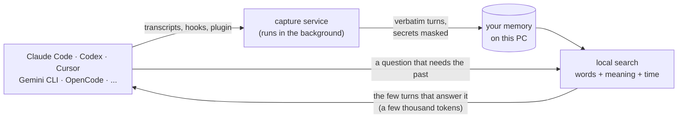

<!-- mcp-name: io.github.goyohan0611-png/turnbook -->
<div align="center">


# Turnbook

### Your AI forgets everything when the session ends. This one remembers, and it never calls an LLM to do it.

**No AI summaries: every conversation is kept word for word, so nothing is lost or made up on the way in, and saving costs zero model tokens. 91.8% on LongMemEval from 3.1k tokens of memory per question ([0.10.0](#does-it-work)). Runs on your own PC.**

[![][license-shield]][license-link]
[![][python-shield]][python-link]
[![][platform-shield]][platform-link]
[![][longmemeval-shield]][benchmarks-link]
[![][ci-shield]][ci-link]
[![][pypi-shield]][pypi-link]
[](https://glama.ai/mcp/servers/goyohan0611-png/turnbook)
[](https://mcpservers.org/servers/goyohan0611-png/turnbook)
[](https://github.com/punkpeye/awesome-mcp-servers#knowledge--memory)

*Decide something with one agent on Monday. Ask another on Wednesday. It knows.*

| | tokens spent **saving** memory | text the answer model reads per question | LongMemEval |
|---|---|---|---|
| **Turnbook 0.10** | **0** | **3.1k tokens** | **91.8%** |
| Turnbook, previous search model | 0 | 26.3k tokens | 91.8% |

<sub>All 500 LongMemEval_S questions, gpt-5-mini answering, official gpt-4o judge. Not the top score: memories that run an LLM over every conversation when saving it publish higher (Mastra's Observational Memory 94.9% with the same answer model). Turnbook stores conversations word for word and spends no model tokens saving them. <a href="#how-it-compares">How it compares</a></sub>

**English** · [한국어](README.ko.md)


<sub>Recorded live on one PC: Claude Code (Opus 5.5, effort high) and Codex (GPT-6.1-Sol, effort high) sharing one Turnbook memory. Model thinking time is fast-forwarded.</sub>

If Turnbook saves you tokens or repeated explanations, a ⭐ helps other people find it.

</div>

## Install

Windows: download [Turnbook-Setup.cmd](https://raw.githubusercontent.com/goyohan0611-png/turnbook/main/scripts/Turnbook-Setup.cmd)
and double-click it, or in PowerShell:

```powershell
irm https://raw.githubusercontent.com/goyohan0611-png/turnbook/main/scripts/install.ps1 | iex
```

macOS / Linux:

```bash
curl -LsSf https://raw.githubusercontent.com/goyohan0611-png/turnbook/main/scripts/install.sh | sh
```

No Python needed; nothing else to set up. Restart your AI apps afterwards. Already have Python?
`pip install turnbook && turnbook-install`. More: [docs/install.md](docs/install.md).

<details>
<summary>Connecting an MCP client by hand</summary>

After `pip install turnbook`:

```json
{
  "mcpServers": {
    "turnbook": {
      "command": "python",
      "args": ["-m", "graph_mind.mcp_server"]
    }
  }
}
```

Claude Code: `claude mcp add turnbook -- python -m graph_mind.mcp_server`. This gives the
tools only; `turnbook-install` also saves every conversation automatically.
</details>

## Try it

Work as usual for a while, then open a new session, another app, or another model and ask:

- *"Where did we leave off yesterday?"*
- *"Which database did we pick for the billing service, and why?"*
- *"What did you change in the auth middleware last week?"*
- *"What's my dog's name?"* (any fact you mentioned once, in passing)

Nothing to tag or save by hand: every turn is already stored, and the agent pulls back the few
that answer the question.

## What it does

- **Every agent, one memory.** Claude Code, Codex, Cursor, Copilot CLI, Gemini CLI, OpenCode and
  any MCP app read and write the same memory. Decide with one, ask another; switch models, the
  memory stays.
- **The right memory in every message.** In Claude Code, Codex, Copilot CLI, Gemini CLI and
  OpenCode, Turnbook looks up what your message needs from the past and adds it before the model
  answers. Nothing to ask for.
- **Free to save, on your PC.** Every turn is stored word for word in one SQLite file: no model
  call, no tokens, no account, no cloud.

<details>
<summary>Everything else</summary>

- **Made for orchestration.** When an orchestrator runs several agents at once, they all write
  to the same memory as they work, so what one agent decided is there for the next. Every
  memory keeps which app and session it came from.
- **Holds up as memory piles up.** With 0.9.47's search model, in a memory of 205,000 turns the
  answer is still among the first 30 found for 79.7% of questions (82.8% at 6,000), and a search takes about 0.4 s.
  [As the memory grows](#as-the-memory-grows)
- **Any language, across languages.** The search model reads Korean almost as well as English:
  ask in Korean about something said in English, or the other way round. [In Korean](#in-korean)
- **Your project's documents too.** `turnbook docs add FOLDER` keeps its Markdown and text files
  searchable beside the conversations, section by section, and up to date as they change.
- **One memory across your PCs.** Run `turnbook folder share`, then `turnbook folder <code>` on
  the other PC (the AI tells you the command; it never moves your memory by itself, so a web page
  cannot either). Office network or [Tailscale](https://tailscale.com), over TLS, every line
  encrypted before it leaves a PC.
- **Hand a memory to someone else as a file.** `turnbook export FILE` writes all of it;
  `--project FOLDER` writes only the conversations held in that folder. They run
  `turnbook import FILE`.
- **Yours.** No account, no cloud of its own, no telemetry. Secrets are masked before anything is
  stored, and *"delete the password I typed earlier"* deletes it everywhere. [docs/privacy.md](docs/privacy.md)
- **Teams, if you want them.** Share a project's decisions and progress with teammates' AIs, never
  your personal memory; files stay in Slack and GitHub. [docs/teams.md](docs/teams.md)

</details>

## Works with

The installer finds these and connects them; run it again after installing a new one.

| app | conversations saved | how |
|---|---|---|
| Claude Code | every turn | reads its transcripts; a hook adds relevant memory to each message |
| Codex CLI | every turn | reads its transcripts; a hook adds relevant memory to each message (trust it once in `/hooks`) |
| Cursor | every turn | reads its transcripts |
| Copilot CLI | every turn | reads its transcripts; a hook adds relevant memory to each message |
| Claude Desktop (Cowork) | every turn | reads its session files |
| Gemini CLI | every turn | hooks; also adds relevant memory before each answer |
| OpenCode | every turn | plugin; also adds relevant memory before each answer, for any model |
| Claude Desktop chat, Windsurf, VS Code Copilot, Cline, LM Studio | what the model saves | MCP tools |

Any other MCP client works through the tools: see the hand-written config above.

## How it works



- **Saving costs nothing.** Turns are stored as they were said. No model summarises or extracts
  anything at write time, so nothing is lost or invented on the way in, and no tokens are spent.
- **Search runs on your PC.** Word search, a local embedding model (Google's EmbeddingGemma,
  4-bit; ONNX, no GPU) and when things were said are combined, then ordered by a small learned
  score; the agent gets a short packet with the source turns, not a dump of history.
- **The model you already use does the thinking.** Turnbook hands it evidence; it answers.
  When models get better, the answers get better without changing the memory.

## Beyond agent memory

Underneath, Turnbook is RAG over chat history with everything before the answer built in. A
typical RAG stack is assembled from parts; Turnbook runs every step up to the answer on its own
and leaves only the answer to the model you already use:

| Step | Typical RAG stack | Turnbook |
|---|---|---|
| Collect | an ingestion script you write | every turn saved automatically from your agents |
| Chunk | splitting rules to tune | one turn per entry, word for word |
| Embed | an embedding API, paid per token | a local model, free |
| Store | a vector database to run | one SQLite file |
| Retrieve | search code to write | words, meaning and time, re-ranked by a small learned score |
| Hand over | prompt-assembly code | a bounded evidence packet over MCP |
| Answer | your LLM | your LLM (Claude, Codex, ...) |

The same engine could serve a chatbot that remembers each of its users, a support bot that
recalls past tickets, or a team's searchable decision log. Today it ships as a personal, local
memory; a Python API and multi-user server mode are not built yet. Interested? Open an issue.

## Does it work?

[LongMemEval](https://github.com/xiaowu0162/LongMemEval) is the public benchmark for long-term
chat memory: 500 questions over about 50 past sessions each. Every Turnbook score here uses the
same answer model (gpt-5-mini), the same prompt and the official gpt-4o judge, and a question the
answer model leaves unanswered counts as wrong.

| | accuracy | model tokens spent **saving** memory | text the answer model reads |
|---|---|---|---|
| **Turnbook 0.10.0** | **91.8%** (all 500) | **0** | **3.1k tokens** |
| Turnbook 0.9.9 | 88.8% (all 500) | 0 | 3.4k tokens |

### How it compares

Other memories publish their own LongMemEval scores, each with its own answer model, judge and
setup, so they are not one ranking. The closest to like-for-like:
[Mastra's Observational Memory](https://mastra.ai/research/observational-memory) reports 94.9%
with the same answer model, gpt-5-mini, which reads about 30k tokens of observations that
gemini-2.5-flash wrote while the conversations were saved. It and others (Mem0, Supermemory) run
an LLM over every conversation when saving it, writing dated facts and replacing outdated ones; that is
where Turnbook loses points: 33 of its 41 misses are questions that combine several sessions,
reason about dates, or need the newest value of something that changed. Turnbook keeps the
original words, spends no model tokens saving them, and runs on your own PC.

On one rival we measured ourselves, with the same reader and judge:
[rohitg00/agentmemory](https://github.com/rohitg00/agentmemory)'s published retrieval gave 80.4%
(Turnbook 0.9.9: 89.0% on the same 499); [details](docs/benchmarks.md).

### Fewer tokens for the same accuracy

0.10.0 changes the search model for new installs from mpnet to EmbeddingGemma. The same 500
questions, the same reader and judge; only the search model and the packet size differ:

| search model | text the answer model reads (median) | accuracy |
|---|---|---|
| mpnet | 3.4k tokens | 86.6% |
| mpnet | 6.7k tokens | 89.6% |
| mpnet | 13.2k tokens | 90.4% |
| mpnet | 26.3k tokens | 91.8% |
| **EmbeddingGemma** | **3.1k tokens** | **91.8%** |

Against mpnet at the same size, EmbeddingGemma answers 33 questions mpnet misses and misses 7 it
answers (p = 0.00004). Questions that need several past sessions gain most: 73.6% → 88.4%. The
re-ranker weights for each model were trained on LoCoMo and LongMemEval together. These packets
held up to 15,000 characters; since 0.10.0 `brain_context` sends up to 30,000 by default
(`max_chars` sets it). Its retrieval on LoCoMo, scored on conversations its weights never saw
(answer turn among the first 10 found): 83.7%, mpnet 70.2%.
[research/runs/graph-v9.14-full500-mpnet8-gemma](research/runs/graph-v9.14-full500-mpnet8-gemma)

### As the memory grows

The charts below were measured with 0.9.47 and its search model (mpnet). With 0.10's model, at
6,000 turns the answer turn is among the first 30 found for 92.5% of questions (0.9.47: 82.8%);
the larger memories are still being measured.

Recall gets harder as memory piles up: more past conversations look like the one you mean. Since 0.9.46
Turnbook orders what it finds with a small learned score instead of a fixed blend. On LoCoMo (1,536
questions), with each person's memory grown to 10× by storing other conversations beside it, the
share of questions whose answer reaches the model fell 5.6 points before (82.5% → 76.9%) and 3.1
points now (83.5% → 80.4%). Each conversation was scored with weights learned on the other nine;
the added conversations are other people's, likely easier to tell apart than one person's own
history. On LongMemEval the same change took the answer reaching the model from 97.5% to 98.3%.

0.9.47 adds more to that score (how rare the shared words are, how much of one past conversation was
found) and looks at 100 candidates per search instead of 50. With LoCoMo inside a memory grown to
205,000 turns, the answer turn is among the first 30 found for 79.7%
of questions, against 73.0% with the fixed blend of 0.9.45; a search takes about 0.4 s there.

<p align="center"></p>

<p align="center"></p>

### In Korean

Four LoCoMo conversations translated into Korean (582 questions). Search by meaning alone, share
of questions whose answer turn is among the first 30 found:

| search model | English | Korean | Korean question, English memory |
|---|---|---|---|
| mpnet | 75.6% | 67.5% | 70.6% |
| **EmbeddingGemma** (0.10.0 default) | **90.2%** | **86.9%** | **87.8%** |

With all of search (words, meaning, re-ranker) on mpnet, 0.9.47 found the answer turn among the
first 30 for 77.5% of Korean questions (84.7% in English); word search finds "콩이" in "콩이를"
(Korean particles). [research/runs/graph-v9.21-korean](research/runs/graph-v9.21-korean)

Every question, answer and verdict is in [`research/runs/`](research/runs); method, failures and
how to rerun it: [docs/benchmarks.md](docs/benchmarks.md).

## FAQ

**Will it slow my PC down?** The background service uses about 2% of one CPU core when nothing new
is coming in. An app's memory server holds about 525 MB with EmbeddingGemma (772 MB with mpnet).
A memory search takes about 40 ms (46 ms at the 95th percentile on a GitHub runner; mpnet 26 ms);
the first one after an app starts, about 1.4 s. Each new turn takes about 0.1 s to embed; the
service runs below normal CPU priority and embeds backlogs at half pace. On a first install, the
conversations already on the PC are read in the background while word search answers at once.

**Which search model?** [EmbeddingGemma](https://huggingface.co/google/embeddinggemma-300m)
(about 200 MB, downloaded from Hugging Face on first use). A memory from 0.9.47 or before keeps
searching with its old model (mpnet) while the background service reads it again with
EmbeddingGemma, a few pieces at a time when nothing else is due; then it moves over by itself.
`turnbook model` shows which model is in use; `turnbook model multilingual` keeps mpnet for good.
EmbeddingGemma is provided under the
[Gemma Terms of Use](https://ai.google.dev/gemma/terms); it is not part of Turnbook's own code
or license.

**What does it cost?** Nothing. No API key and no model calls of its own; your AI app reads a
packet of a few thousand tokens when a question needs the past.

**Does anything leave my PC?** No, unless you share the memory with your own other PCs or a team.
No telemetry. Secrets (API keys, passwords, card numbers...) are masked before storing.

**How is this different from CLAUDE.md or an app's built-in memory?** Those keep notes a model
wrote, one app at a time. Turnbook keeps every turn as it was said and shares it across every
app and model on the PC.

**Korean?** Yes: Korean and English conversations, and questions in either language. With the
default model, search by meaning trails English by about 3 points in Korean, and a Korean
question finds an English memory about as often: [In Korean](#in-korean).

**How do I remove it?** `turnbook-uninstall` disconnects every app and stops the service; the
memory stays in `~/.graph-mind` unless you add `--purge`.

> [!NOTE]
> **Beta.** Used daily on Windows. macOS and Linux pass every test in CI but have not seen daily
> use yet.

## More

[MCP tools](docs/install.md#mcp-tools) · [See your memory in 3D](docs/privacy.md#seeing-your-memory)
(`turnbook-view`) · [Changelog](CHANGELOG.md) · [Security](SECURITY.md) ·
Development: `pip install -r requirements.txt`, then `python -m unittest discover -s tests`

Contributions are welcome. License: [Apache-2.0](LICENSE).

<!-- Links -->
[license-shield]: https://img.shields.io/badge/license-Apache--2.0-4dc9f6?style=flat-square
[license-link]: LICENSE
[python-shield]: https://img.shields.io/badge/python-3.10+-7dd8f8?style=flat-square&logo=python&logoColor=white
[python-link]: https://www.python.org/
[platform-shield]: https://img.shields.io/badge/platform-Windows%20%7C%20macOS%20%7C%20Linux-b0e8ff?style=flat-square
[platform-link]: docs/benchmarks.md#known-limits
[longmemeval-shield]: https://img.shields.io/badge/LongMemEval-91.8%25-2ea44f?style=flat-square
[benchmarks-link]: docs/benchmarks.md
[ci-shield]: https://img.shields.io/github/actions/workflow/status/goyohan0611-png/turnbook/tests.yml?style=flat-square&label=tests
[ci-link]: https://github.com/goyohan0611-png/turnbook/actions/workflows/tests.yml
[pypi-shield]: https://img.shields.io/pypi/v/turnbook?style=flat-square&label=pypi&cacheSeconds=3600
[pypi-link]: https://pypi.org/project/turnbook/
